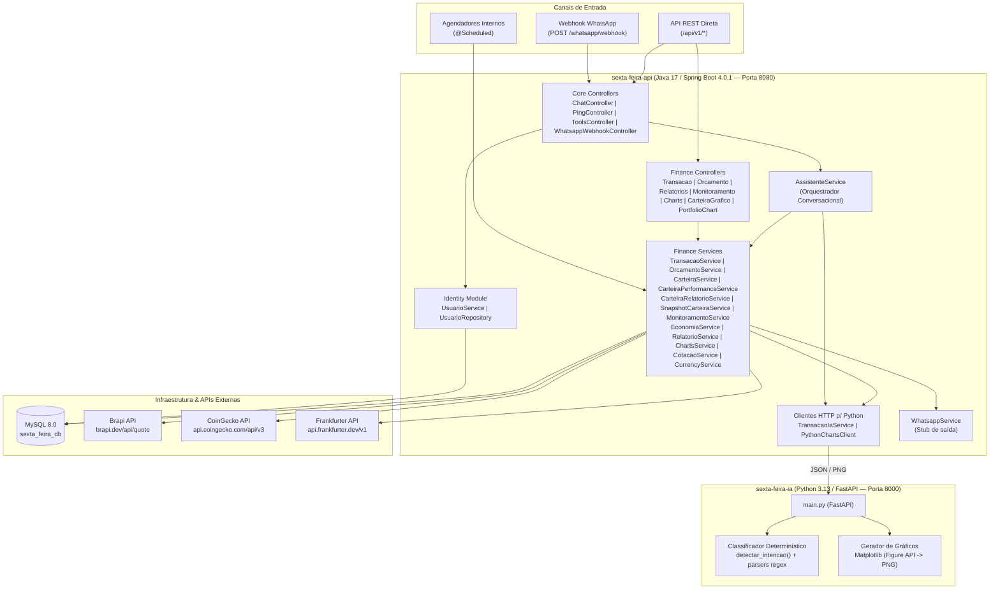
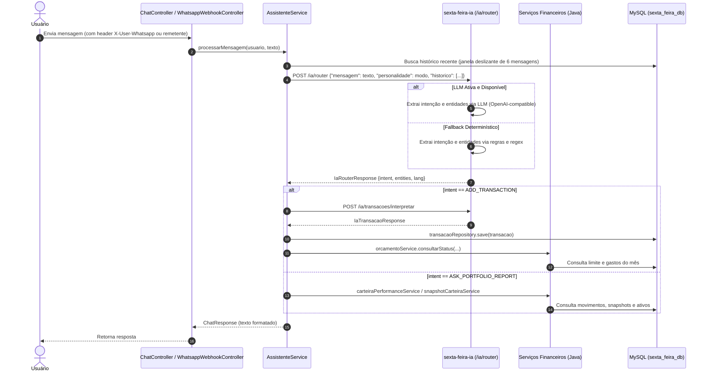

# Arquitetura do Sistema — Sexta-Feira (`ARCHITECTURE.md`)

Este documento descreve a arquitetura **real e atual** do projeto Sexta-Feira, suas responsabilidades, fluxos de dados, integrações externas e dívidas técnicas mapeadas.

---

## 1. Visão Geral e Topologia dos Módulos

O sistema utiliza uma arquitetura de dois serviços acoplados via HTTP REST síncrono, apoiados por um banco de dados relacional MySQL:

---

## 2. Responsabilidades de Cada Módulo

### 2.1. Backend Principal (`sexta-feira-api`)
Localizado em `sexta-feira-api/`, é o **núcleo transacional e autoritativo** do sistema:
- **Orquestração Conversacional (`core.service.AssistenteService`):** Recebe o texto do usuário, consulta o roteador Python (`/ia/router`), decide qual operação de negócio acionar no switch de `intent` e formata a resposta textual com frases de personalidade (`FrasesService`).
- **Gestão de Identidade (`identity`):** Gerencia o cadastro de usuários (`Usuario`) vinculados ao número do WhatsApp (`whatsapp_number`).
- **Domínio Financeiro (`modes.finance`):**
  - **Fluxo de Caixa (`TransacaoService`, `OrcamentoService`, `EconomiaService`, `RelatorioService`, `MonitoramentoService`):** Registra receitas/despesas, calcula resumos por mês ou intervalo de datas, verifica limites de orçamento por categoria (alertas em 80%, 90% e 100%+), compara gastos entre semanas para sugerir cortes e gera relatórios consolidados.
  - **Investimentos e Carteira (`CarteiraService`, `CarteiraPerformanceService`, `CarteiraRelatorioService`, `SnapshotCarteiraService`):** Controla posição de ativos (`ACAO`, `FII`, `CRIPTO`), registra movimentações (`COMPRA`, `VENDA`, `APORTE_BRL`), captura snapshots diários de patrimônio e calcula rentabilidade e rankings (`Top N` melhores e piores ativos no período).
  - **Cotações e Câmbio (`CotacaoService`, `CurrencyService`):** Consome APIs externas (Brapi para B3, CoinGecko para criptoativos em BRL e Frankfurter/ECB para câmbio de moedas fiduciárias).

### 2.2. Serviço de IA e Gráficos (`sexta-feira-ia`)
Localizado em `sexta-feira-ia/`, é um serviço **stateless** em Python/FastAPI com **arquitetura híbrida de inteligência**:
- **Roteamento Híbrido com Suporte a LLMs (`POST /ia/router`):**
  - **Nível 1 (LLM Function Calling):** Se `LLM_ENABLED=true` e configurado (`LLM_BASE_URL`, `LLM_API_KEY`, `LLM_MODEL`), aciona qualquer provedor compatível com OpenAI (OpenAI, Groq, Ollama local) para interpretação contextual e resolução de anáforas sobre o histórico recente.
  - **Nível 2 (Fallback Determinístico Garantido):** Se a LLM estiver desativada, demorar mais que o timeout configurado (`LLM_TIMEOUT_SECONDS`) ou falhar, o roteador determinístico de regras/regex entra em ação instantaneamente sem gerar indisponibilidade.
  - Retorna `intent`, `entities` (valores, tickers, classes, datas, personalidades, timeframes) e `lang`.
- **Interpretação de Transações (`POST /ia/transacoes/interpretar`):** Extrai `valor` (`Decimal`), `data` (`date`), `tipo` (`DESPESA`/`RECEITA`), `categoria` e `descricao` a partir de uma frase.
- **Renderização de Gráficos (`POST /ia/charts/*`):** Recebe séries numéricas pré-calculadas pelo Java e renderiza imagens `image/png` em memória (`BytesIO`) utilizando a API orientada a objetos do Matplotlib (`Figure` com backend `Agg`).

---

## 3. Fluxos Principais de Requisição

### 3.1. Fluxo de Mensagem Conversacional (Chat / WhatsApp)

### 3.2. Fluxo de Geração de Gráficos
1. O usuário requisita `GET /api/v1/charts/gastos-mes.png` (ou `/orcamento-vs-gasto.png`, `/evolucao-gastos-mes.png`, `/api/v1/carteira/grafico`).
2. O controller Java aciona `ChartsService` ou `SnapshotCarteiraService`, que consulta o MySQL e agrega os dados em DTOs (`ChartCategoriaRequestDTO`, `ChartBudgetRequestDTO`, `ChartSerieRequestDTO`).
3. `PythonChartsClient` envia um `POST` JSON para `sexta-feira-ia` (`/ia/charts/*`).
4. O FastAPI gera o gráfico com Matplotlib em buffer de memória e devolve `image/png` (`byte[]`).
5. O controller Java repassa o `byte[]` com `Content-Type: image/png` ao cliente.

---

## 4. Modelo de Dados Atual (MySQL)

Tabelas gerenciadas pelo Hibernate (`spring.jpa.hibernate.ddl-auto=update`), todas isoladas por `usuario_id`:
- `usuarios`: ID, nome, número de WhatsApp (único), personalidade (`SEXTA_FEIRA`, `FORMAL`, `AMIGAVEL`, `JARVIS`), criado_em.
- `mensagens_historico`: ID, `usuario_id`, papel (`USER`, `ASSISTANT`), conteúdo, intenção, `criado_em`. Garante memória conversacional isolada por usuário.

| Tabela | Entidade JPA | Chave Primária | Unique Constraints Atuais |
| :--- | :--- | :--- | :--- |
| `usuarios` | `Usuario` | `id` (Auto Increment) | `whatsapp_number` |
| `transacoes` | `Transacao` | `id` (Auto Increment) | Nenhuma |
| `orcamentos` | `Orcamento` | `id` (Auto Increment) | Nenhuma no banco (controlado via código por `ano, mes, categoria`) |
| `alertas_orcamento` | `AlertaOrcamento` | `id` (Auto Increment) | `(ano, mes, categoria, tipoAlerta)` |
| `ativos_carteira` | `AtivoCarteira` | `id` (Auto Increment) | `(classe, ticker)` |
| `movimentos_carteira` | `MovimentoCarteira` | `id` (Auto Increment) | Nenhuma |
| `snapshots_carteira` | `SnapshotCarteira` | `id` (Auto Increment) | `uk_snapshot (data, classe, ticker)` |

---

## 5. Decisões Arquiteturais e Dívidas Técnicas Conhecidas

1. **Separação Java (Negócio) vs Python (NLP/Gráficos):**
   - *Justificativa:* Permite manter a segurança tipada, persistência JPA e regras financeiras no ecossistema Spring Boot, enquanto aproveita o ecossistema Python para processamento de linguagem natural e visualização de dados (`matplotlib`).
2. **Dívidas Técnicas Ativas (Alvo da Etapa 3 e Etapa 4):**
   - **Ausência de `usuario_id` nas tabelas financeiras:** Atualmente `usuarios` está desacoplado das outras 6 tabelas (registrado como `[SEC-02]` em [docs/PROJECT_AUDIT.md](PROJECT_AUDIT.md)).
   - **Monolito em `sexta-feira-ia/main.py`:** As pastas `sexta-feira-ia/app/*` foram criadas para modularização futura, mas a implementação atual está concentrada em `main.py`.
   - **Migrações de Schema:** O projeto usa `ddl-auto=update` em desenvolvimento. Mudanças estruturais de chaves estrangeiras e unique constraints na Etapa 3 exigirão cuidado para preservar compatibilidade com H2 (testes) e MySQL (desenvolvimento).
