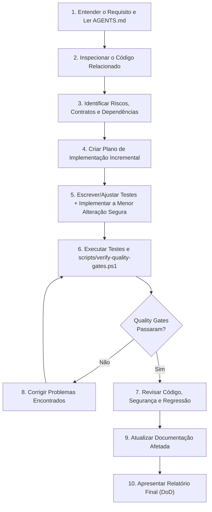

# Fluxo de Trabalho de Desenvolvimento (`DEVELOPMENT_WORKFLOW.md`)

Este documento descreve o procedimento padrão de 10 passos que deve ser seguido por qualquer desenvolvedor ou agente de IA ao executar uma tarefa no projeto **Sexta-Feira**.

---

## Diagrama do Fluxo de Trabalho



---

## Passo a Passo Detalhado

### 1. Entender o Requisito
- Leia a solicitação do usuário e identifique a qual etapa do projeto ela pertence.
- Consulte [AGENTS.md](../AGENTS.md) e os documentos específicos em `docs/` antes de tomar decisões.
- Se houver ambiguidade crítica (ex: escolha de provedor externo pago ou regra de negócio conflitante), pergunte antes de assumir.

### 2. Inspecionar o Código Relacionado
- Localize todas as classes Java e funções Python impactadas.
- Verifique como os dados fluem desde o controller/webhook até o repositório JPA e/ou endpoint FastAPI.

### 3. Identificar Riscos e Dependências
- Avalie se a mudança afeta contratos JSON entre Java e Python.
- Avalie o impacto no schema do banco de dados (`MySQL` e `H2` de teste).
- Avalie riscos de segurança (exposição de dados de outros usuários, falta de validação, timeouts).

### 4. Criar um Plano de Implementação
- Divida alterações grandes em passos pequenos e verificáveis.
- Nunca misture refatorações cosméticas amplas com correções críticas de segurança ou regras financeiras.

### 5. Implementar a Menor Alteração Segura (Preferencialmente com TDD)
- Para correções de bugs ou regras de isolamento de usuário, escreva primeiro o teste automatizado que evidencia a falha ou o requisito.
- Implemente a alteração mínima e limpa necessária para satisfazer o requisito seguindo [docs/CODING_STANDARDS.md](CODING_STANDARDS.md).

### 6. Executar Testes e Quality Gates Automatizados
- Execute a suíte do módulo alterado e, em seguida, rode o verificador geral:
  ```powershell
  powershell -ExecutionPolicy Bypass -File .\scripts\verify-quality-gates.ps1
  ```

### 7. Revisar o Código e a Segurança
- Faça um `git diff` mental ou via ferramenta para revisar todas as linhas alteradas.
- Passe pelo checklist de [docs/SECURITY.md](SECURITY.md) e [docs/QUALITY_GATES.md](QUALITY_GATES.md).

### 8. Corrigir Problemas Encontrados
- Se qualquer teste, linter ou verificação de segurança falhar, corrija imediatamente antes de prosseguir. Nunca desative a verificação.

### 9. Atualizar Documentação
- Atualize `README.md`, `docs/ARCHITECTURE.md` ou ADRs (`docs/adr/`) caso algum contrato, fluxo ou configuração tenha mudado.

### 10. Apresentar o Relatório Final
- Entregue o relatório seguindo estritamente o template de [docs/DEFINITION_OF_DONE.md](DEFINITION_OF_DONE.md), aguardando a aprovação do usuário antes de iniciar a próxima fase.
