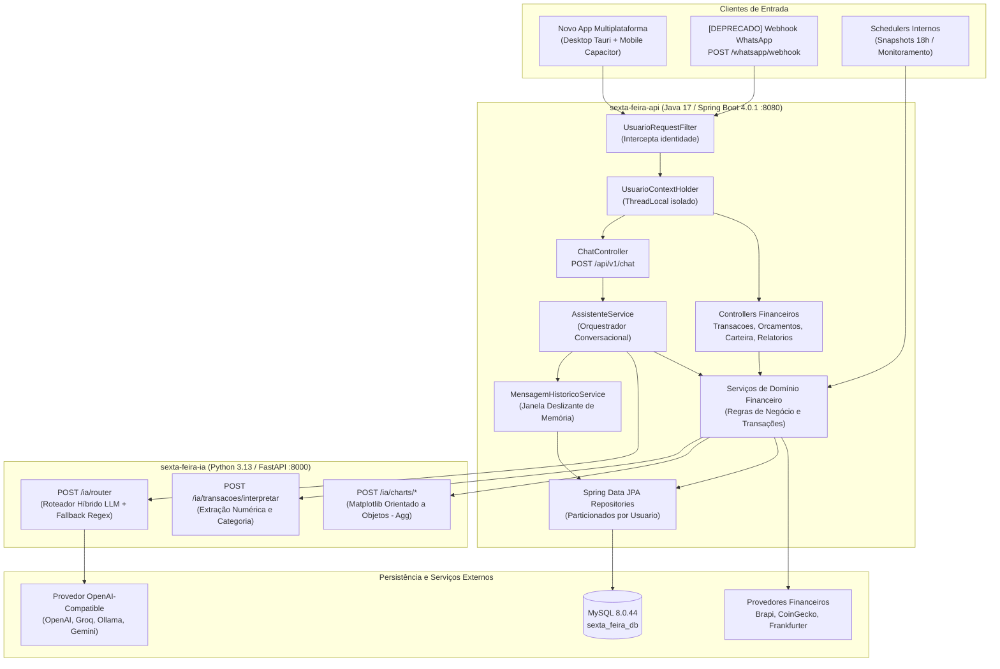
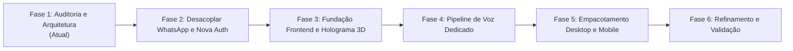

# Auditoria de Integração Frontend, Identidade e Pipeline de Voz (`docs/FRONTEND_INTEGRATION_AUDIT.md`)

**Data da Auditoria:** 24/10/2026  
**Projeto:** Sexta-Feira — Assistente Pessoal Multiplataforma  
**Status:** Fase 1 Concluída (Auditoria, Arquitetura e Decisões de Engenharia)  
**Documentos Relacionados:** [AGENTS.md](../AGENTS.md), [ARCHITECTURE.md](ARCHITECTURE.md), [SECURITY.md](SECURITY.md), [QUALITY_GATES.md](QUALITY_GATES.md), [PROJECT_AUDIT.md](PROJECT_AUDIT.md)

---

## 1. Arquitetura Atual Confirmada

O backend da Sexta-Feira está estabilizado, testado e particionado com isolamento multiusuário em todas as entidades financeiras:



---

## 2. Endpoints Disponíveis e Contratos Confirmados

A auditoria inspecionou todos os 11 controllers em `sexta-feira-api/src/main/java/` e o serviço `sexta-feira-ia/main.py`.

### 2.1. Endpoints do Backend Java (`sexta-feira-api`)

| Método | Endpoint | Finalidade | Status / Contrato |
| :--- | :--- | :--- | :--- |
| `POST` | `/api/v1/chat` | Envia mensagem conversacional e recebe resposta formatada no estilo da personalidade ativa. | **Confirmado.** Entrada: `{ "mensagem": string }`. Saída: `{ "resposta": string }`. |
| `GET` | `/api/v1/ping` | Healthcheck simples da API. | **Confirmado.** Retorna `"SEXTA-FEIRA online"`. |
| `POST` | `/api/v1/tools/convert` | Conversão de moedas via Frankfurter API. | **Confirmado.** Entrada: `{ "amount": number, "from": string, "to": string }`. Saída: `{ "amount": number, "base": string, "target": string, "rate": number, "result": number }`. |
| `GET` | `/api/v1/transacoes` | Lista todas as transações do usuário ordenadas por data desc. | **Confirmado.** Retorna `List<Transacao>`. |
| `POST` | `/api/v1/transacoes` | Cria transação estruturada. | **Confirmado.** Entrada: `Transacao` (valor, tipo, categoria, data, descricao). |
| `GET` | `/api/v1/transacoes/resumo` | Resumo financeiro de um mês (total receitas, despesas, saldo). | **Confirmado.** Params: `ano`, `mes`. Saída: `ResumoMensalDTO`. |
| `POST` | `/api/v1/transacoes/natural` | Cria transação a partir de texto em linguagem natural. | **Confirmado.** Entrada: `{ "texto": string }`. Retorna `NaturalLanguageTransacaoResponse`. |
| `DELETE` | `/api/v1/transacoes/ultima` | Remove a última transação cadastrada pelo usuário. | **Confirmado.** Retorna `Transacao` removida. |
| `POST` | `/api/v1/transacoes/delete-por-texto` | Exclui transação combinando parâmetros informados em texto. | **Confirmado.** Entrada: `{ "texto": string }`. Retorna `int` (quantidade removida). |
| `POST` | `/api/v1/orcamentos` | Cria ou atualiza teto de gastos para uma categoria em determinado ano/mês. | **Confirmado.** Entrada: `OrcamentoRequest`. Saída: `Orcamento`. |
| `GET` | `/api/v1/orcamentos/status` | Consulta limite, gasto realizado e percentual consumido. | **Confirmado.** Params: `ano`, `mes`, `categoria`. Saída: `StatusOrcamentoDTO`. |
| `GET` | `/api/v1/relatorios/mensal` | Relatório consolidado do mês com links de gráficos. | **Confirmado.** Saída: `RelatorioMensalResponse`. |
| `POST` | `/api/v1/monitoramento/checar-agora`| Força checagem de estouro de orçamentos e envio de alertas. | **Confirmado.** Retorna mensagem de status. |
| `GET` | `/api/v1/charts/gastos-mes.png` | Gera PNG dos gastos por categoria do mês atual. | **Confirmado.** Retorna `image/png`. |
| `GET` | `/api/v1/charts/orcamento-vs-gasto.png` | Gera PNG comparativo de orçado vs realizado. | **Confirmado.** Retorna `image/png`. |
| `GET` | `/api/v1/charts/portfolio/last` | Gera PNG da evolução do último ranking de carteira consultado. | **Confirmado.** Retorna `image/png`. |
| `GET` | `/api/v1/carteira/grafico` | Gera PNG da evolução de patrimônio por período e classe. | **Confirmado.** Params opcionais: `range`, `days`, `classe`. Retorna `image/png`. |
| `POST` | `/whatsapp/webhook` | Webhook de recebimento de mensagens do provedor WhatsApp. | **LEGADO / A REMOVER.** |

### 2.2. Lacunas de Contratos Necessárias para o Frontend Multiplataforma

Identificamos **3 lacunas de contratos** no backend que precisam ser criadas para suportar a aplicação rica:

1. **`GET /api/v1/mensagens/historico` (Inexistente):** O serviço `MensagemHistoricoService` já armazena e recupera a memória conversacional no backend, mas **não há endpoint REST expondo o histórico para o frontend**. O app precisa carregar a conversa prévia ao abrir a aplicação.
2. **`GET/PUT /api/v1/usuario/perfil` (Inexistente):** Atualmente a personalidade é trocada apenas via comando em linguagem natural no chat (`"mude para o modo jarvis"`). O app precisa de um endpoint para consultar e alterar preferências do usuário (personalidade ativa, idioma preferido, nome de exibição).
3. **Endpoints de Autenticação (`/api/v1/auth/*`):** Atualmente a identidade é inferida pelo header `X-User-Whatsapp` ou webhook. É necessário criar endpoints de autenticação por token (login, registro, refresh).

### 2.3. Tipos TypeScript dos Contratos Confirmados

```typescript
// frontend/src/types/api.ts

export type Personalidade = 'SEXTA_FEIRA' | 'FORMAL' | 'AMIGAVEL' | 'JARVIS';
export type IdiomaPreferido = 'pt-BR' | 'en-US';
export type TipoTransacao = 'DESPESA' | 'RECEITA';
export type CategoriaTransacao = 
  | 'ALIMENTACAO' 
  | 'TRANSPORTE' 
  | 'MORADIA' 
  | 'SAUDE' 
  | 'EDUCACAO' 
  | 'LAZER' 
  | 'INVESTIMENTOS' 
  | 'OUTROS';

export type ClasseAtivo = 'ACAO' | 'FII' | 'CRIPTO' | 'RENDA_FIXA' | 'OUTRO';

export interface ChatRequest {
  mensagem: string;
}

export interface ChatResponse {
  resposta: string;
}

export interface HistoricoMensagemDTO {
  role: 'user' | 'assistant' | 'system';
  content: string;
}

export interface ResumoMensalDTO {
  ano: number;
  mes: number;
  totalReceitas: number;
  totalDespesas: number;
  saldo: number;
}

export interface StatusOrcamentoDTO {
  categoria: CategoriaTransacao;
  limite: number;
  gasto: number;
  restante: number;
  percentualConsumido: number;
  estourado: boolean;
}

export interface UsuarioPerfilDTO {
  id: number;
  email: string;
  nome: string;
  personalidade: Personalidade;
  idiomaPreferido: IdiomaPreferido;
}
```

---

## 3. Plano de Desacoplamento do WhatsApp

A decisão de produto de abandonar o WhatsApp requer eliminar a dependência externa sem perder dados financeiros ou funcionalidades existentes.

### 3.1. Mapa de Todas as Referências ao WhatsApp no Monorepo

| Componente | Arquivo | O que faz hoje | Ação de Desacoplamento / Substituição |
| :--- | :--- | :--- | :--- |
| **Webhook Controller** | `WhatsappWebhookController.java` | Recebe payload JSON do provedor de WhatsApp e dispara chat. | **Remover.** Substituído pela API nativa `/api/v1/chat` com autenticação JWT. |
| **Serviço de Envio** | `WhatsappService.java` | Envia HTTP POST para API externa do WhatsApp (mockado em stdout). | **Remover.** Substituído por serviço interno de notificações (`NotificacaoService`). |
| **DTOs de WhatsApp** | `WhatsappIncomingMessageDTO.java`, `WhatsappOutgoingMessageDTO.java` | Estruturas de dados de mensagens do WhatsApp. | **Remover.** |
| **Entidade de Usuário** | `Usuario.java` (`whatsappNumber`) | Chave de identidade do usuário no banco (`whatsapp_number`). | **Migrar.** Adicionar campos `email` (único), `nome` e `senha_hash`. Tornar `whatsapp_number` opcional/deprecado e posterior drop da coluna. |
| **Filtro de Contexto** | `UsuarioRequestFilter.java` | Lê `X-User-Whatsapp` para identificar o usuário. | **Substituir.** Renomear para `JwtAuthenticationFilter` que extrai e valida token `Bearer <JWT>`. |
| **Serviço de Usuário** | `UsuarioService.java` | Métodos `buscarOuCriarPorWhatsapp` e fallback `defaultWhatsapp`. | **Refatorar.** Criar métodos de autenticação por e-mail/senha (`buscarPorEmail`, `autenticar`, `cadastrar`). |
| **Monitoramento & Alertas** | `MonitoramentoService.java` | Envia mensagem de WhatsApp quando orçamento atinge 80%, 90% ou estoura. | **Preservar a regra, trocar o canal.** Gravar alertas em nova tabela `notificacao_usuario` para leitura pelo frontend (`GET /api/v1/notificacoes`), mantendo log e WebSocket/SSE para aviso em tempo real. |
| **Configurações** | `application.properties` | `whatsapp.api.url`, `whatsapp.api.token`, `whatsapp.webhook.secret`, `monitoramento.whatsapp.to`, `sexta.auth.default-whatsapp`. | **Limpar.** Remover chaves obsoletas do WhatsApp e configurar chaves de segurança da nova auth (`sexta.security.jwt.secret`, `expiration`). |
| **Testes** | `IsolamentoUsuarioIntegrationTest.java` | Cria usuários de teste com strings como `"5511999990001"`. | **Refatorar.** Ajustar fixtures para criar usuários com e-mail/nome sem quebrar a lógica de teste de isolamento. |

### 3.2. Estratégia de Migração do Banco de Dados sem Perda de Dados

Criamos a especificação da migração SQL incremental em `docs/migrations/etapa5-desacoplar-whatsapp.sql`:

1. **Alteração da Tabela `usuario`:**
   ```sql
   ALTER TABLE usuario 
     ADD COLUMN email VARCHAR(150) NULL UNIQUE AFTER id,
     ADD COLUMN nome VARCHAR(100) NULL AFTER email,
     ADD COLUMN senha_hash VARCHAR(255) NULL AFTER nome,
     ADD COLUMN idioma_preferido VARCHAR(10) NOT NULL DEFAULT 'pt-BR' AFTER personalidade,
     MODIFY COLUMN whatsapp_number VARCHAR(30) NULL;
   ```
2. **Backfill de Dados Existentes:** Usuários antigos recebem `email = CONCAT('usuario_', id, '@sextafeira.local')` e senha provisória encriptada com BCrypt, garantindo que todas as chaves estrangeiras de transações, orçamentos e carteiras permaneçam 100% íntegras.
3. **Criação da Tabela `notificacao_usuario`:** Armazena alertas de orçamento e mensagens de sistema para consulta pela aplicação multiplataforma.

---

## 4. Avaliação de Identidade e Autenticação

### 4.1. Fragilidade da Solução Atual
Atualmente, qualquer cliente com acesso à porta 8080 pode enviar o cabeçalho `X-User-Whatsapp: 5511...` e operar como se fosse aquele usuário. Isso era aceitável em ambiente de laboratório para testes de isolamento multiusuário, mas é **inadmissível para um aplicativo em produção (desktop e celular)**.

### 4.2. Nova Arquitetura de Autenticação Proposta
Adotaremos autenticação baseada em **Tokens JWT (JSON Web Tokens)** assinados com HMAC-SHA256 (`jjwt` 0.12+):

- **Access Token:** Validade curta (15 a 60 minutos), trafegado no cabeçalho `Authorization: Bearer <token>`. Contém `sub` (ID do usuário) e `email`.
- **Refresh Token:** Validade média (30 dias), rotacionável, armazenado com segurança:
  - *No Desktop (Tauri):* Armazenamento seguro via Tauri Store criptografada ou Secure Storage nativo do SO (Windows Credential Manager / DPAPI).
  - *No Mobile (Capacitor):* Capacitor Secure Storage (Keystore no Android / Keychain no iOS).
  - *No Navegador (Web):* Cookie HttpOnly, Secure, SameSite=Strict (mitigando roubo via XSS).
- **Sem LocalStorage para Tokens de Longa Duração:** Proteção explícita contra ataques XSS.

---

## 5. Comparação de Tecnologias para Desktop e Celular

A assistente precisa de uma interface rica, holograma 3D fluido via WebGL/shaders, captura contínua de microfone e empacotamento para Windows e celular (Android/iOS).

### Matriz Comparativa de Tecnologias:

| Critério | Opção 1: React + Vite + Tauri 2.0 (Desktop) + Capacitor (Mobile) | Opção 2: React Native + Expo (Mobile) + Electron (Desktop) | Opção 3: Flutter (Desktop + Mobile) | Opção 4: Web PWA pura |
| :--- | :--- | :--- | :--- | :--- |
| **Reaproveitamento de Código** | **95%** (mesmo código React/TS, shaders GLSL e Three.js para todas as plataformas) | ~60% (código compartilhado, mas interfaces 3D diferem entre React Native e Web/Electron) | **90%** (mesmo código Dart, porém reescreve todo o frontend) | 100% (código único, mas sem binário nativo) |
| **Gráficos 3D / Shaders WebGL** | **Excelente** (WebGL 2.0 nativo via Chromium WebView / WebKit / WebView2) | Moderado (Three.js no Expo GL possui gargalos de post-processing) | Complexo (Shader shaders customizados via Impeller/GLSL) | **Excelente** (WebGL nativo) |
| **Consumo de Memória / Tamanho** | **Excelente** (~15 MB instalador Tauri no Windows, ~20 MB APK Capacitor) | Péssimo no desktop (~120 MB instalador Electron, consome ~250 MB RAM) | Bom (~25 MB instalador) | **Excelente** (zero download) |
| **Permissões de Microfone e Áudio** | **Excelente** (APIs nativas do Capacitor Permissions no Android/iOS; WebView2 no Windows) | Excelente (Expo Audio) | Excelente (Plugins Dart) | Limitado (depende das políticas do navegador móvel) |
| **Barge-in / Interrupção de Fala** | **Total** (Web Audio API direta com AnalyserNode e AudioWorklet) | Complexo (pontes assíncronas do React Native) | Bom | Bom |
| **Ergonomia e Curva de Aprendizado** | **Alta** (TypeScript, ecossistema Web maduro, Vite HMR ultrarrápido) | Média | Baixa (exige aprender Dart) | Alta |

### Recomendação Fundamentada
> [!IMPORTANT]
> **Adotar a Opção 1: Monorepo Frontend com React 19 + TypeScript + Vite + Tailwind CSS**, empacotado para Desktop com **Tauri 2.0** e para Celular com **Capacitor 6/7**.
> 
> **Por que esta escolha é superior?**
> 1. Permite criar uma única cena Three.js / React Three Fiber com shaders GLSL avançados (filamentos holográficos e pós-processamento de bloom) que roda com 60+ FPS em Windows e Android/iOS sem duplicar código.
> 2. O Tauri 2.0 utiliza a WebView nativa do Windows (WebView2), gerando um executável leve (< 20 MB) com consumo mínimo de memória RAM, ao contrário do Electron.
> 3. O Capacitor fornece pontes estáveis e consolidadas para permissões de gravação de áudio no Android/iOS e execução em segundo plano.

---

## 6. Comparação das Opções de Pipeline de Voz Dedicado

O usuário expressou a decisão de **não depender exclusivamente das APIs nativas do navegador (`webkitSpeechRecognition` / `speechSynthesis`)**, exigindo um pipeline dedicado, bilíngue (Português e Inglês), com interrupção instantânea (*barge-in*) e voz natural com expressividade.

### 6.1. Análise Comparativa dos Modelos e Protocolos

| Abordagem | Arquitetura | Latência Total | Qualidade da Voz (PT-BR / EN) | Suporte a Interrupção (Barge-in) | Custos Estimados | Confiabilidade / Privacidade |
| :--- | :--- | :--- | :--- | :--- | :--- | :--- |
| **Opção A: Multimodal Live Bidirecional (Gemini Multimodal Live / OpenAI Realtime)** | WebSocket ou WebRTC único de áudio bidirecional (STT+LLM+TTS no mesmo modelo) | **Ultra-baixa** (300ms - 600ms) | **Excepcional** (entonação nativa, pausas humanas, sussurro, riso) | **Nativo** (o servidor cancela a geração assim que detecta voz do usuário no fluxo de entrada) | Médio a Alto (~$0.06/min áudio in, ~$0.24/min áudio out) | Depende de conexão estável com o provedor. Dados trafegam para nuvem. |
| **Opção B: Pipeline Desacoplado de Alta Velocidade (Groq Whisper + LLM + Cartesia/ElevenLabs/Edge-TTS)** | STT rápido (Groq Whisper) -> Roteador Python -> Streaming TTS (Cartesia Sonic ou Edge-TTS) | **Baixa** (600ms - 1.000ms) | **Muito Alta** (vozes neurais ultra-realistas em PT-BR e EN) | **Gerenciado** (VAD local no cliente interrompe reprodução do áudio e emite cancelamento no WebSocket) | **Baixo a Moderado** (Groq STT é $0.006/min; Edge-TTS é gratuito; Cartesia é ~$0.05/1k caracteres) | **Modularidade Máxima:** Permite trocar o STT, a LLM ou o TTS individualmente conforme os estudos de IA avançam. |
| **Opção C: Pipeline 100% On-Device / Local (Whisper.cpp + Ollama + Piper TTS)** | Todo o processamento executado na máquina local | **Média a Alta** (1.500ms - 3.500ms dependendo da GPU/CPU) | Razoável (Piper TTS possui boas vozes, mas menos expressividade) | Manual (VAD local corta o player) | **Zero custo de API** | **Privacidade Total.** Pesado para celulares modestos. |

### 6.2. Abstração `VoiceProvider` (Arquitetura Proposta)

Para garantir que a assistente nunca fique presa a um único fornecedor e possa incorporar modelos próprios no futuro, criaremos a interface abstrata:

```typescript
// frontend/src/voice/VoiceProvider.ts

export type VoiceState = 'idle' | 'listening' | 'processing' | 'speaking' | 'interrupted' | 'error';

export interface VoiceProviderEvents {
  onStateChange: (state: VoiceState) => void;
  onTranscript: (text: string, isFinal: boolean) => void;
  onAudioChunk: (chunk: Float32Array) => void; // Para sincronização do holograma
  onError: (error: Error) => void;
}

export interface VoiceProvider {
  readonly id: string;
  readonly state: VoiceState;
  
  initialize(events: VoiceProviderEvents): Promise<void>;
  startListening(mode: 'push_to_talk' | 'continuous'): Promise<void>;
  stopListening(): Promise<void>;
  interruptSpeaking(): void; // Interrompe áudio imediatamente (Barge-in)
  setVolume(volume: number): void;
  setLanguage(language: 'pt-BR' | 'en-US'): void;
  destroy(): Promise<void>;
}
```

### 6.3. Mecânica de Interrupção (*Barge-In*)
1. O cliente mantém um nó Web Audio `AnalyserNode` ou um `AudioWorklet` com VAD (*Voice Activity Detection*) leve rodando na thread de áudio.
2. Quando a assistente está no estado `speaking` e o VAD detecta voz do usuário com energia superior ao limiar configurado por mais de 120ms:
   - O player de áudio local executa `gainNode.gain.linearRampToValueAtTime(0, audioContext.currentTime + 0.05)` (fade-out instantâneo de 50ms para evitar estalo no fone).
   - O player interrompe a fila de chunks de áudio remotos.
   - O cliente emite evento de interrupção para o backend (`INTERRUPT`).
   - O estado da interface transiciona imediatamente para `interrupted` e logo para `listening`.

---

## 7. Proposta de Sistema Visual: Núcleo Holográfico Original

### 7.1. Direção de Arte e Identidade
- **Conceito:** A Sexta-Feira não é uma esfera sólida nem um círculo plano. Ela é uma **entidade cinemática vetorial** inspirada em projeções volumétricas avançadas: um núcleo de filamentos de dados (*data filaments*), órbitas de partículas energéticas e camadas de geometria euclidiana semi-translúcidas que parecem se auto-organizar continuamente no espaço tridimensional.
- **Evitar Tells de IA:** 
  - Sem esferas azuis genéricas ou gradientes roxos sem função.
  - Sem cards brancos flutuantes com sombras borradas.
  - Sem emojis substituindo ícones funcionais.
  - Tipografia de precisão industrial/técnica com legibilidade humanista.

### 7.2. Paleta de Cores e Tokens Luminosos
```css
/* frontend/src/styles/tokens.css */
:root {
  --canvas-deep: #05070B;         /* Preto espacial profundo com undertone ciano */
  --canvas-surface: #0B0F17;      /* Superfície de controles secundários */
  --canvas-border: rgba(45, 114, 210, 0.15); /* Bordas milimétricas técnicas */
  
  --holo-core: #2DE2E6;           /* Ciano holográfico vivo (energia primária) */
  --holo-accent: #028090;         /* Ciano profundo para filamentos de fundo */
  --holo-warmth: #F5A623;         /* Âmbar dourado sutil para ênfase e alertas */
  --holo-alert: #FF3366;          /* Magenta elétrico para estouros de orçamento/erros */
  
  --text-primary: #E8EEF5;        /* Branco luminoso de alto contraste */
  --text-secondary: #7E92A8;      /* Cinza técnico balanceado */
  --text-dim: #435263;            /* Metadados e números de telemetria */
}
```

### 7.3. Os 6 Estados Reativos do Holograma
A geometria e os shaders do holograma reagem diretamente aos dados do `AnalyserNode` da Web Audio API:

1. **`idle`:** Rotação lenta de filamentos concêntricos em velocidade orbital serena. Pulsação suave (0.2 Hz) sugerindo prontidão constante.
2. **`listening`:** Abertura da geometria tridimensional. Partículas externas vibram em frequência e amplitude idênticas à entrada da voz capturada pelo microfone do usuário.
3. **`processing`:** Compressão momentânea dos filamentos em direção ao centro, simulando condensação de energia e cálculo analítico, acompanhado por partículas que se alinham em eixos matemáticos.
4. **`speaking`:** Ondas harmônicas volumétricas se expandem do núcleo sincronizadas com as frequências do áudio de resposta da assistente. A amplitude da fala modula o brilho de emissão do shader.
5. **`interrupted`:** Descompressão abrupta com dispersão elástica de partículas que se reagrupam rapidamente no estado `listening`.
6. **`error`:** Transição de tom para magenta/âmbar com oscilação de baixa frequência, retornando com dignidade para o estado de prontidão após 2 segundos.

### 7.4. Composição da Tela
- **Viewport Desktop e Mobile:**
  - **Centro:** A cena Three.js preenche a tela como elemento hero absoluto.
  - **Topo:** Indicador de telemetria discreto (modo de voz, status da conexão, chave seletora de idioma PT-BR / EN, botão minimalista de histórico).
  - **Base:** Barra de interação permanente com botão táctil de microfone (*push-to-talk* e trava para contínuo) e campo de texto com tipografia limpa que nunca desaparece durante a conversa por voz.
  - **Mobile:** Reorganização ergonômica com suporte total a *safe-areas* (iOS Notch/Dynamic Island e Navigation Bar do Android).

---

## 8. Riscos de Segurança e Dados Pessoais

1. **Proteção do Microfone e Transparência:**
   - O aplicativo deve exibir um indicador visual nativo inconfundível quando o microfone estiver capturando áudio.
   - O áudio nunca deve ser transmitido sem consentimento ou no modo texto puro.
2. **Gestão de Segredos:**
   - Proibido armazenar chaves de API de provedores de IA ou voz (OpenAI, Groq, ElevenLabs, Gemini) no código do frontend ou nos binários de distribuição (Tauri/Capacitor). Todas as chaves residirão exclusivamente no backend Java ou no serviço Python.
3. **Isolamento de Dados Financeiros:**
   - Todas as requisições de consulta ou mutação financeira do app serão assinadas com o JWT do usuário e validadas pelo `UsuarioRequestFilter` no Spring Boot.
   - Nenhuma ferramenta de IA terá permissão de execução direta de SQL no banco de dados.

---

## 9. Plano de Execução em 6 Fases



### Detalhamento das Próximas Fases:

- **Fase 2 — Desacoplamento do WhatsApp e Nova Autenticação:**
  - Criar migração SQL `etapa5-desacoplar-whatsapp.sql` (adicionar `email`, `nome`, `senha_hash` em `Usuario`).
  - Implementar autenticação JWT (`AuthController`, `JwtService`, `JwtAuthenticationFilter`).
  - Criar `NotificacaoService` e tabela de notificações para substituir alertas de WhatsApp.
  - Criar endpoints faltantes: `GET /api/v1/mensagens/historico` e `GET/PUT /api/v1/usuario/perfil`.
  - Deprecar e remover `WhatsappWebhookController` e `WhatsappService`.
  - Atualizar testes de isolamento com a nova autenticação.
- **Fase 3 — Fundação do Frontend e Núcleo Holográfico:**
  - Inicializar monorepo frontend em `frontend/` com React 19, TypeScript, Vite, Tailwind CSS.
  - Construir sistema de design holográfico em `frontend/docs/DESIGN_SYSTEM.md`.
  - Implementar cena Three.js / React Three Fiber com shaders de filamentos e partículas reativas.
  - Integrar chat de texto via API REST com streaming de digitação e histórico.
- **Fase 4 — Pipeline de Voz Dedicado:**
  - Implementar interface `VoiceProvider` no frontend e gateway de voz no backend.
  - Integrar captura de microfone, VAD e cancelamento instantâneo (*barge-in*).
  - Conectar frequências de áudio ao shader do holograma via Web Audio `AnalyserNode`.
  - Validar alternância bilíngue natural entre Português e Inglês.
- **Fase 5 — Empacotamento Multiplataforma (Desktop e Celular):**
  - Configurar Tauri 2.0 para Windows.
  - Configurar Capacitor para Android e iOS.
  - Validar permissões de microfone e ciclo de vida da aplicação em telas de diferentes tamanhos.
- **Fase 6 — Refinamento, Auditoria Final e Quality Gates:**
  - Suíte completa de testes de frontend (Vitest + Playwright para componentes).
  - Execução dos Quality Gates integrados (`scripts/verify-quality-gates.ps1`).

---

## 10. Decisões Arquiteturais Pendentes para Alinhamento

Para iniciarmos a **Fase 2**, solicitamos a validação das seguintes decisões de produto:

1. **Estratégia de Provedor de Voz Principal:**
   - **Opção Recomendada:** Iniciar com o **Pipeline Desacoplado de Baixa Latência** (Groq Whisper STT + Python Router/LLM + Edge-TTS gratuito / Cartesia de alta fidelidade). Essa opção garante **custo quase zero no desenvolvimento**, latência inferior a 800ms e total modularidade para você plugar seus próprios modelos de rede neural no futuro.
   - *Alternativa:* Usar o **Gemini Multimodal Live API** ou **OpenAI Realtime API** com transporte WebRTC (voz ultra-expressiva, porém com custo de token por minuto de áudio).
2. **Formato de Credenciais no Primeiro Acesso:**
   - Podemos gerar um usuário padrão (ex.: `admin@sextafeira.local`) na migração para que sua base atual de transações e investimentos seja automaticamente associada à sua conta sem necessidade de reinserção de dados.
3. **Aprovação para Início da Fase 2:**
   - Confirmação para implementar o desacoplamento do WhatsApp, a migração do schema `Usuario` e a autenticação JWT no backend Java.
