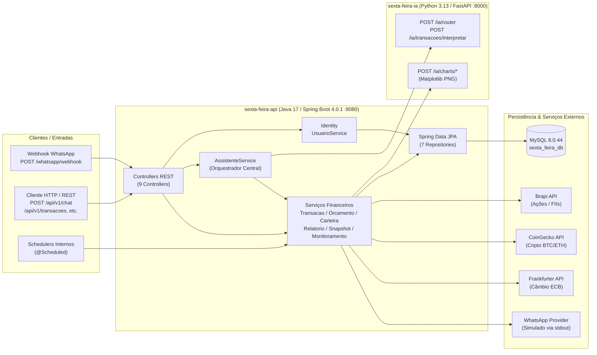

# Auditoria Completa do Projeto — Sexta-Feira (`PROJECT_AUDIT.md`)

**Data da Auditoria:** 23/10/2026  
**Repositório Local:** `C:\Users\User\Desktop\Projetos TI\sexta-feira`  
**Escopo desta Etapa:** Etapa 0 — Diagnóstico completo de arquitetura, código, integrações, banco de dados, segurança, testes e plano de execução priorizado (nenhuma linha de código funcional foi alterada).

---

## 1. Arquitetura Atual Confirmada

O repositório é um monorepo contendo dois módulos independentes que se comunicam via HTTP síncrono (JSON / PNG bytes):

### 1.1. Módulo Backend (`sexta-feira-api`)
- **Stack:** Java 17 (Temurin 17.0.17), Spring Boot `4.0.1`, Spring Data JPA (Hibernate ORM `7.2.0.Final`), Bean Validation, MySQL Connector/J.
- **Total de arquivos Java:** 83 classes de produção (`src/main/java`) + 1 classe de teste (`src/test/java`).
- **Organização de Pacotes (`br.com.yann.sextafeira`):**
  - `core`: Configuração HTTP (`RestTemplate`), controllers gerais (`ChatController`, `PingController`, `ToolsController`), webhook (`WhatsappWebhookController`), orquestrador (`AssistenteService`, `FrasesService`), integração Python (`PythonChartsClient`) e WhatsApp (`WhatsappService`).
  - `identity`: Entidade `Usuario`, `UsuarioRepository` e `UsuarioService`.
  - `modes.finance`: Domínio financeiro completo (7 controllers, 11 modelos/enums, 6 repositories, 20 DTOs, 3 schedulers, 12 services e integração Brapi).

### 1.2. Módulo de Inteligência e Gráficos (`sexta-feira-ia`)
- **Stack:** Python `3.13.14` (em `sexta-feira-ia/venv`), FastAPI `0.128.0`, Pydantic `2.12.5`, Uvicorn `0.40.0`, Matplotlib `3.10.8`.
- **Estado Estrutural:** Todo o código funcional (794 linhas) reside em `sexta-feira-ia/main.py`. Há uma árvore de pacotes preparada (`app/api/routes.py`, `app/charts/plotter.py`, `app/core/dates.py`, `app/core/normalize.py`, `app/core/parsers.py`, `app/models/*`, `app/routers/finance_router.py`), porém **todos esses 9 arquivos dentro de `app/` estão com 0 bytes (vazios)**. Além disso, `git status` aponta que `app/main.py` foi movido para `main.py` na raiz do módulo sem commit.

---

## 2. Mapeamento de Endpoints e Contratos

### 2.1. Endpoints Java (`sexta-feira-api` — Porta `8080`)

| Controller | Método e Rota | Entrada | Saída | Efeito Colateral / Observação |
| :--- | :--- | :--- | :--- | :--- |
| `PingController` | `GET /api/v1/ping` | — | `String` (`"SEXTA-FEIRA online"`) | Healthcheck simples. |
| `ChatController` | `POST /api/v1/chat` | `ChatRequest` (`mensagem`) | `ChatResponse` (`resposta`) | Chama Python `/ia/router` e executa ação (cria/remove transação, altera carteira, define orçamento, consulta relatórios). |
| `WhatsappWebhookController` | `POST /whatsapp/webhook` | `WhatsappIncomingMessageDTO` (`from`, `message`) | `200 OK` (`void`) | Cria/busca `Usuario` pelo `from`, chama `assistenteService.processarMensagem(texto)` **sem passar o usuário**, e imprime resposta no console. |
| `ToolsController` | `POST /api/v1/tools/convert` | `ConvertRequest` (`amount`, `from`, `to`) | `ConvertResponse` | Consulta taxa em `api.frankfurter.dev`. |
| `TransacaoController` | `GET /api/v1/transacoes` | — | `List<Transacao>` | Retorna **todas** as transações do banco (`findAll()`). |
| `TransacaoController` | `POST /api/v1/transacoes` | `Transacao` (entidade JPA direta) | `Transacao` (`201`) | Salva transação diretamente sem DTO de entrada nem `@Valid`. |
| `TransacaoController` | `GET /api/v1/transacoes/resumo` | `@RequestParam ano, mes` | `ResumoMensalDTO` | Soma receitas, despesas e saldo do mês. |
| `TransacaoController` | `POST /api/v1/transacoes/natural` | `NaturalLanguageTransacaoRequest` | `NaturalLanguageTransacaoResponse` (`201`) | Chama Python `/ia/transacoes/interpretar` e salva no MySQL. |
| `TransacaoController` | `DELETE /api/v1/transacoes/ultima` | — | `Transacao` | Apaga a última transação global (`findTopByOrderByIdDesc()`). |
| `TransacaoController` | `POST /api/v1/transacoes/remover-por-texto` | `DeletePorTextoRequest` | `Transacao` | Interpreta texto no Python e apaga transação candidata dos últimos 60 dias. |
| `OrcamentoController` | `POST /api/v1/orcamentos` | `OrcamentoRequest` | `Orcamento` (`201`) | Cria ou atualiza limite mensal por categoria. |
| `OrcamentoController` | `GET /api/v1/orcamentos/status` | `@RequestParam ano, mes, categoria` | `StatusOrcamentoDTO` | Calcula gasto vs limite da categoria no mês. |
| `RelatoriosController` | `GET /api/v1/relatorios/mensal` | — | `RelatorioMensalResponse` | Gera resumo mensal, top 3 categorias, alertas e URLs de gráficos. |
| `MonitoramentoController` | `POST /api/v1/monitoramento/checar-agora` | — | `String` | Dispara verificação imediata de estouro/80%/90% de orçamentos e grava `AlertaOrcamento`. |
| `ChartsController` | `GET /api/v1/charts/gastos-mes.png` | — | `byte[]` (`image/png`) | Busca gastos do mês e gera gráfico de barras no Python. |
| `ChartsController` | `GET /api/v1/charts/orcamento-vs-gasto.png` | — | `byte[]` (`image/png`) | Gera gráfico comparativo Orçamento vs Gasto no Python. |
| `ChartsController` | `GET /api/v1/charts/evolucao-gastos-mes.png` | — | `byte[]` (`image/png`) | Gera série diária de gastos em linha no Python. |
| `CarteiraGraficoController` | `GET /api/v1/carteira/grafico` | `@RequestParam range, days, classe` | `byte[]` (`image/png`) | Gera gráfico de linha da evolução patrimonial a partir de `SnapshotCarteira`. |
| `PortfolioChartController` | `GET /api/v1/charts/portfolio/last` | — | `byte[]` (`image/png`) | Gera gráfico usando o estado em memória `ultimoRankingContext` do singleton `SnapshotCarteiraService`. |

### 2.2. Endpoints Python (`sexta-feira-ia` — Porta `8000`)

| Método e Rota | Entrada (Pydantic) | Saída | Função |
| :--- | :--- | :--- | :--- |
| `GET /` | — | `{"status": "ok", "service": "sexta-feira-ia"}` | Healthcheck. |
| `POST /ia/transacoes/interpretar` | `MensagemRequest` (`mensagem`) | `TransacaoInterpretada` (`valor`, `data`, `tipo`, `categoria`, `descricao`) | Extração baseada em regex e palavras-chave. |
| `POST /ia/router` | `MensagemRequest` (`mensagem`) | `RouterResponse` (`intent`, `entities`, `lang`) | Classifica entre 16 intenções + `UNKNOWN` e extrai entidades. |
| `POST /ia/charts/gastos-por-categoria` | `ChartCategoriaRequest` | `StreamingResponse` (`image/png`) | Gráfico de barras simples via Matplotlib (`plt`). |
| `POST /ia/charts/orcamento-vs-gasto` | `ChartBudgetRequest` | `StreamingResponse` (`image/png`) | Gráfico de barras duplas via Matplotlib (`plt`). |
| `POST /ia/charts/serie-linha` | `ChartSerieRequest` | `StreamingResponse` (`image/png`) | Gráfico de linha temporal via Matplotlib (`plt`). |

---

## 3. Estado das Funcionalidades

### 3.1. Funcionalidades Confirmadas e Implementadas
- **Registro e exclusão de transações em linguagem natural:** Implementado via `/ia/router`, `/ia/transacoes/interpretar`, `AssistenteService` e `TransacaoService`.
- **Consultas de gastos, resumos mensais e por período:** Implementado (`TODAY`, `YESTERDAY`, `THIS_WEEK`, `LAST_WEEK`, `THIS_MONTH`, `LAST_MONTH`, `LAST_N_DAYS`).
- **Dicas de economia comparando semana atual vs semana passada:** Implementado em `EconomiaService.sugerirCortesSemana()`.
- **Orçamentos por categoria e alertas de limite (80%, 90% e estouro):** Implementado tanto no momento de inserção via chat (`AssistenteService`) quanto em background (`MonitoramentoService` / `MonitoramentoScheduler`) com deduplicação mensal na tabela `alertas_orcamento`.
- **Carteira de investimentos (Ações, FIIs, Cripto):** Adição/venda por quantidade (`ADD_HOLDING_QTY`, `SELL_HOLDING_QTY`) e aporte por valor em reais (`ADD_HOLDING_VALUE`) convertendo pela cotação atual.
- **Snapshots diários, cálculo de rentabilidade e ranking (Top N melhores/piores):** Implementado em `SnapshotCarteiraService` e `CarteiraPerformanceService`.
- **Cotações externas e câmbio:** Integração implementada com Brapi (`CotacaoService`), CoinGecko (`CotacaoService`) e Frankfurter (`CurrencyService`).
- **Geração de gráficos PNG:** Implementada ponta a ponta entre Java e Python.

### 3.2. Funcionalidades Parcialmente Implementadas ou Desconectadas
1. **Isolamento Multi-Usuário e Vínculo com `Usuario` (0% conectado ao domínio financeiro):**
   - A entidade `Usuario` (`usuarios`) e o `UsuarioService.buscarOuCriarPorWhatsapp()` existem.
   - No entanto, **nenhuma entidade financeira** (`Transacao`, `Orcamento`, `AlertaOrcamento`, `AtivoCarteira`, `MovimentoCarteira`, `SnapshotCarteira`) possui chave estrangeira (`usuario_id` / `@ManyToOne Usuario`).
   - O próprio `WhatsappWebhookController` contém o comentário explícito na linha 41: `// 2) processar mensagem (por enquanto ainda sem usar o usuário)`.
2. **Modos de Personalidade (`Personalidade.java`):**
   - O enum `Personalidade` (`SEXTA_FEIRA`, `FORMAL`, `AMIGAVEL`, `JARVIS`) existe e está mapeado na entidade `Usuario`.
   - Porém, **não é lido em nenhum serviço**. Todas as respostas do `AssistenteService`, `FrasesService`, `EconomiaService`, `RelatorioService` e `CarteiraPerformanceService` têm frases sarcásticas fixas (hardcoded) no código Java.
3. **Integração de Envio WhatsApp (`WhatsappService.java`):**
   - É apenas um stub que executa `System.out.println("Simulando envio para WhatsApp...")`. O `RestTemplate`, `whatsappApiUrl` e `whatsappApiToken` são injetados na classe, mas nunca são utilizados.
4. **Modularização do Serviço Python (`sexta-feira-ia/app/*`):**
   - A estrutura de pastas `app/api`, `app/charts`, `app/core`, `app/models`, `app/routers` foi criada, mas todos os arquivos estão vazios; o código permanece monolítico em `main.py`.
5. **DTO duplicado/não utilizado:**
   - `DefinirOrcamentoRequest.java` e o enum `TipoAtivo.java` existem no projeto, mas não são usados por nenhuma classe.

### 3.3. Funcionalidades que Não Puderam Ser Verificadas Ponta a Ponta nesta Auditoria
- **Envio real para provedor WhatsApp:** Não há implementação HTTP real em `WhatsappService` e a URL configurada é um placeholder (`https://SUA_URL_DO_PROVEDOR_AQUI`).
- **Cotação Brapi autenticada com múltiplos ativos:** `brapi.token` não está definido no `application.properties`, dependendo do tier público da Brapi.

---

## 4. Testes Executados e Resultados Reais

Durante a auditoria, as ferramentas e testes existentes foram executados no ambiente local:

### 4.1. Ambiente Detectado
- **Java:** OpenJDK Temurin `17.0.17+10` (64-bit).
- **Banco de Dados Local:** MySQL `8.0.44` ativo em `localhost:3306` com schema `sexta_feira_db` acessível.
- **Python:** `Python 3.13.14` no ambiente virtual `sexta-feira-ia\venv`.

### 4.2. Execução do Maven (`sexta-feira-api`)
1. **Comando padrão (`mvnw.cmd test`):**
   - **Resultado:** **FALHOU (`BUILD FAILURE`)** logo na fase `maven-resources-plugin:3.3.1:resources`.
   - **Causa:** `MalformedInputException: Input length = 1` ao filtrar `src/main/resources/application.properties`. O arquivo `application.properties` está salvo em codificação `ISO-8859-1` / `Windows-1252` (contém caracteres acentuados como `padrão`, `Configuração`, `serviço` em 1 byte), enquanto o Spring Boot 4.0.1 / Maven tenta filtrá-lo como `UTF-8`.
2. **Comando contornando encoding (`mvnw.cmd test -Dproject.build.sourceEncoding=ISO-8859-1`):**
   - **Resultado:** **PASSOU (`BUILD SUCCESS` — 1 teste executado, 0 falhas, 36.1s)**.
   - **Observação crítica sobre o teste existente:** O único teste (`SextaFeiraApiApplicationTests.contextLoads()`) sobe o contexto real do Spring Boot conectando ao banco MySQL local (`sexta_feira_db`), executa `Hibernate ddl-auto=update` (rodando `ALTER TABLE` reais) e dispara o `MonitoramentoScheduler` durante o teste! Não há isolamento de banco de testes nem testes unitários das regras de negócio.

### 4.3. Verificação do Serviço Python (`sexta-feira-ia`)
1. **Testes automatizados existentes:** **0 arquivos de teste** (`pytest` sequer está listado no `requirements.txt`).
2. **Diagnóstico de dependências (`requirements.txt` vs `venv`):**
   - `matplotlib` (e seus pacotes transitivos `numpy`, `pillow`, `contourpy`, `kiwisolver`, `pyparsing`, `python-dateutil`, `cycler`, `fonttools`) está instalado no `venv`, mas **NÃO consta no `requirements.txt`**. Uma instalação limpa via `pip install -r requirements.txt` falhará ao iniciar o `main.py` com `ModuleNotFoundError: No module named 'matplotlib'`.
3. **Smoke test funcional executado na auditoria:**
   - Foi executado um teste de importação e chamada direta das funções de `main.py` usando o Python do `venv`.
   - **Descoberta de Bug Real no Router:** Ao testar `main.router(MensagemRequest(mensagem='quanto gastei essa semana'))`, o serviço retornou **`intent='ADD_TRANSACTION'`** com `valor=0.0` em vez de `ASK_PERIOD_SUMMARY`!
   - **Causa raiz do bug:** Na função `detectar_intencao(mensagem)` (`main.py` linhas 5411-5415), a verificação de `ADD_TRANSACTION` testa se `"gastei"` está na frase **antes** de verificar `ASK_PERIOD_SUMMARY` (linhas 5456-5463), que procura `"quanto gastei"` / `"gastei quanto"`. Como `"quanto gastei essa semana"` contém `"gastei"`, toda pergunta do usuário com a palavra `"gastei"` é interceptada como adição de despesa de R$ 0,00!

---

## 5. Riscos de Segurança e Problemas Identificados (Diagnóstico Inicial vs. Estado Atual Resolvido)

> [!NOTE]
> Os itens abaixo representam o **diagnóstico original da Etapa 0**. Conforme demonstrado na Matriz de Rastreabilidade (Seção 7) e validado pela suíte de testes de regressão (33 testes automatizados e 5 Quality Gates), **todos os problemas críticos, altos e médios abaixo foram corrigidos e testados com sucesso nas Etapas 1, 3 e 4**.

### 🔴 Severidade CRÍTICA (Bloqueantes — Segurança e Isolamento)

1. **[SEC-01] Credenciais e Dados Pessoais Expostos em Texto Puro no Código e no Histórico Git — [RESOLVIDO NA ETAPA 3]**
   - **Diagnóstico Inicial:** Senha do banco de dados MySQL (`spring.datasource.password`), token da API do WhatsApp (`whatsapp.api.token`) e número de telefone pessoal (`monitoramento.whatsapp.to`) estavam hardcoded em `application.properties`.
   - **Estado Atual:** Todas as propriedades sensíveis foram externalizadas para variáveis de ambiente via `.env.example`, `.gitignore` configurado e verificado estritamente pelo GATE-03 de Secret Scanning.

2. **[SEC-02] Ausência Absoluta de Isolamento de Dados por Usuário (Multi-Tenancy Inexistente) — [RESOLVIDO NA ETAPA 3]**
   - **Diagnóstico Inicial:** As entidades financeiras não possuíam associação com `Usuario`.
   - **Estado Atual:** Todas as 6 entidades financeiras (`Transacao`, `Orcamento`, `AlertaOrcamento`, `AtivoCarteira`, `MovimentoCarteira`, `SnapshotCarteira`) e o histórico (`MensagemHistorico`) foram vinculados obrigatoriamente a `Usuario`. Repositórios e serviços operam exclusivamente particionados por usuário, comprovado por 12 testes de integração em `IsolamentoUsuarioIntegrationTest`.

3. **[SEC-03] Ausência de Autenticação e Autorização nos Endpoints REST e no Webhook — [RESOLVIDO NA ETAPA 3]**
   - **Diagnóstico Inicial:** Endpoints sem identificação ou validação de remetente.
   - **Estado Atual:** Webhook protegido por `X-Webhook-Token`. Filtro `UsuarioRequestFilter` associando o contexto seguro na thread via `UsuarioContextHolder`.

---

### 🟠 Severidade ALTA (Bugs Funcionais, Integridade Financeira e Concorrência)

4. **[BUG-01] Colisão de Intenção no Python: `"quanto gastei..."` Cadastra Transação de R$ 0,00 — [RESOLVIDO NA ETAPA 3]**
   - **Diagnóstico Inicial:** Substring `"gastei"` interceptava perguntas de resumo.
   - **Estado Atual:** Precedência de intenções corrigida e validada por teste unitário `test_router_quanto_gastei_nao_deve_criar_transacao_bug01`.

5. **[BUG-02] Dupla Contabilização de Movimentos e Cotações Duplicadas em `adicionarPorValorBRL` — [RESOLVIDO NA ETAPA 3]**
   - **Diagnóstico Inicial:** Aporte em reais gravava `APORTE_BRL` e `COMPRA`.
   - **Estado Atual:** `CarteiraService` ajustado para gravar apenas um movimento e atualizar posição sem duplicar cotação externa.

6. **[BUG-03] Quebra do Build Maven por Encoding Inválido em `application.properties` — [RESOLVIDO NA ETAPA 1]**
   - **Diagnóstico Inicial:** Falha de compilação por encoding ISO-8859-1.
   - **Estado Atual:** `application.properties` e `pom.xml` convertidos para UTF-8.

7. **[BUG-04] `requirements.txt` Incompleto e Divergência de Entrypoint — [RESOLVIDO NAS ETAPAS 1 E 4]**
   - **Diagnóstico Inicial:** Falta de `matplotlib` e divergência entre `main.py` e `app/main.py`.
   - **Estado Atual:** `requirements.txt` completo; `app/main.py` unificado como módulo proxy reexportando `main.py` (instância única comprovada por teste).

8. **[CONC-01] Estado Mutável Compartilhado em Singleton (`SnapshotCarteiraService`) — [RESOLVIDO NA ETAPA 3]**
   - **Diagnóstico Inicial:** `ultimoRankingContext` compartilhado entre todas as requisições.
   - **Estado Atual:** Contexto movido para mapa concorrente particionado por `Usuario`.

9. **[CONC-02] Dois Schedulers Duplicados para Snapshot da Carteira — [RESOLVIDO NA ETAPA 3]**
   - **Diagnóstico Inicial:** Dois agendadores às 02:00 e 18:00.
   - **Estado Atual:** `SnapshotCarteiraScheduler.java` removido; scheduler único às 18:00 `America/Sao_Paulo`.

10. **[CONC-03] Uso da Interface Estadual `matplotlib.pyplot` (`plt`) em Servidor Web Concorrente — [RESOLVIDO NA ETAPA 1]**
    - **Diagnóstico Inicial:** `plt.figure()` concorrente causava colisão de plotagem.
    - **Estado Atual:** Substituído por API orientada a objetos (`Figure`) com backend `Agg` explícito.

---

### 🟡 Severidade MÉDIA (Resiliência, Precisão e Dívida Técnica)

11. **[RES-01] `RestTemplate` sem Timeouts Configurados e Duplicado — [RESOLVIDO NA ETAPA 1]**
    - **Diagnóstico Inicial:** Bloqueio indefinido de threads em caso de indisponibilidade de APIs externas.
    - **Estado Atual:** Timeouts de conexão (5s) e leitura (15s) centralizados em `HttpConfig.java`.

12. **[CFG-01] Inconsistência nas Propriedades de URL do Serviço Python — [RESOLVIDO NA ETAPA 1]**
    - **Diagnóstico Inicial:** Chaves divergentes (`sexta.ia.url`, `ia.base-url`, constantes hardcoded).
    - **Estado Atual:** Unificado em `${sexta.ia.url:http://127.0.0.1:8000}` em todos os serviços.

13. **[FIN-01] Uso de `float` / `double` em Contratos Intermediários e Extração Regex Frágil — [RESOLVIDO NA ETAPA 3]**
    - **Diagnóstico Inicial:** Capturava o dia do mês como valor monetário em `"dia 15 gastei 40 reais"`.
    - **Estado Atual:** Função `_limpar_tokens_nao_monetarios` filtra datas e tickers antes da extração de valores, validada por testes.

14. **[FIN-02] Permite Venda de Ativo Sem Saldo ou Quantidade Negativa Sem Validação Clara — [RESOLVIDO NA ETAPA 3]**
    - **Diagnóstico Inicial:** Venda sem saldo gravava movimento fantasma.
    - **Estado Atual:** Validação prévia de saldo em `CarteiraService.adicionarQuantidade`, lançando `IllegalArgumentException` se saldo insuficiente.

15. **[DB-01] Ausência de Transações (`@Transactional`) em Operações Multi-Tabela — [RESOLVIDO NA ETAPA 3]**
    - **Diagnóstico Inicial:** Operações parciais sem rollback no banco.
    - **Estado Atual:** Anotações `@Transactional` aplicadas em todas as mutações multi-tabela em `TransacaoService`, `OrcamentoService`, `CarteiraService` e `SnapshotCarteiraService`.

---

## 6. Plano de Execução Priorizado

Seguindo estritamente a governança definida para o projeto, as próximas fases devem ser executadas na ordem abaixo, **uma fase por vez**, com revisão e aprovação ao final de cada etapa:

### Etapa 1 — Estabilização e Recuperação da Capacidade de Execução
1. Converter `application.properties` para `UTF-8` e fixar `<project.build.sourceEncoding>UTF-8</project.build.sourceEncoding>` no `pom.xml`.
2. Configurar perfil de teste (`src/test/resources/application-test.properties` + H2/isolamento ou desativação de schedulers em teste) para que `mvnw test` não altere o banco de desenvolvimento nem dispare schedulers.
3. Regularizar o Git e dependências do `sexta-feira-ia`: consolidar localização de `main.py`, atualizar `requirements.txt` (incluindo `matplotlib`, `pytest`, `httpx`) e remover ou estruturar os arquivos vazios em `app/`.
4. Unificar a propriedade `sexta.ia.url`, injetar `RestTemplate` único com timeouts (`connectTimeout` e `readTimeout`) e adicionar tratamento de falha de comunicação (`RestClientException`) entre Java e Python sem expor stack traces.

### Etapa 2 — Documentação Técnica, Governança e Quality Gates Automatizados
1. Criar os documentos oficiais:
   - `AGENTS.md` (na raiz)
   - `docs/ARCHITECTURE.md`
   - `docs/CODING_STANDARDS.md`
   - `docs/TESTING_STRATEGY.md`
   - `docs/SECURITY.md`
   - `docs/QUALITY_GATES.md`
   - `docs/DEFINITION_OF_DONE.md`
   - `docs/DEVELOPMENT_WORKFLOW.md`
2. Implementar script executável de verificação automatizada (Quality Gate Runner) que valide compilação, testes Java, testes Python e ausência de segredos hardcoded.

### Etapa 3 — Segurança, Isolamento Multi-Usuário e Integridade Financeira (CONCLUÍDA)
1. **Gestão de Segredos:** Externalizar `spring.datasource.password`, `whatsapp.api.token` e `monitoramento.whatsapp.to` para variáveis de ambiente; criar `.env.example` e atualizar `.gitignore`. *(CONCLUÍDO)*
2. **Isolamento de Dados por Usuário (`Usuario`):**
   - Associar `Usuario` a `Transacao`, `Orcamento`, `AlertaOrcamento`, `AtivoCarteira`, `MovimentoCarteira` e `SnapshotCarteira` (ajustando unique constraints para incluir `usuario_id`). *(CONCLUÍDO)*
   - Propagar o contexto do usuário autenticado/identificado em `AssistenteService` e em todos os serviços e repositórios financeiros via `UsuarioContextHolder` e `UsuarioRequestFilter`. *(CONCLUÍDO)*
   - Escrever testes automatizados provando que o Usuário A não lê, altera ou deleta dados do Usuário B. *(CONCLUÍDO - 12 testes em `IsolamentoUsuarioIntegrationTest`)*
3. **Correção dos Bugs de Integridade Financeira e Concorrência:**
   - Corrigir a dupla contabilização em `CarteiraService.adicionarPorValorBRL` ([BUG-02]) e validar saldo antes de venda ([FIN-02]). *(CONCLUÍDO)*
   - Corrigir a precedência de intenção `"quanto gastei"` ([BUG-01]) e o parser de valor com números de data/quantidade ([FIN-01]) em `sexta-feira-ia`. *(CONCLUÍDO)*
   - Adicionar `@Transactional` onde aplicável, eliminar `ultimoRankingContext` global ([CONC-01]), remover scheduler duplicado ([CONC-02]) e usar API Orientada a Objetos (`Figure`) no Matplotlib ([CONC-03]). *(CONCLUÍDO)*
4. **Script de Migração e Backfill:** `docs/migrations/etapa3-multiusuario.sql` gerado com instruções manuais para associar dados pré-existentes ao usuário dono e remover constraints legadas no MySQL. *(CONCLUÍDO)*

---

## 7. Matriz de Rastreabilidade e Resolução dos Problemas Identificados

| ID | Classificação | Problema | Etapa de Resolução | Status | Evidência de Verificação |
|---|---|---|---|---|---|
| `[SEC-01]` | 🔴 Crítica | Segredos expostos em `application.properties` | Etapa 3 | **RESOLVIDO** | `verify-quality-gates.ps1` (GATE-03) executado sem `-AllowLegacySecrets` |
| `[SEC-02]` | 🔴 Crítica | Falta de isolamento multiusuário nas entidades financeiras | Etapa 3 | **RESOLVIDO** | `IsolamentoUsuarioIntegrationTest` (6 entidades isoladas por `Usuario`) |
| `[SEC-03]` | 🔴 Crítica | Endpoints sem auth / webhook sem validação / SSRF | Etapa 3 | **RESOLVIDO** | Validação de token em `WhatsappWebhookController`, regex em tickers e moedas |
| `[BUG-01]` | 🟠 Alta | `"quanto gastei"` cria transação zerada | Etapa 3 | **RESOLVIDO** | `sexta-feira-ia/tests/test_main.py` (teste de intenção `ASK_PERIOD_SUMMARY`) |
| `[BUG-02]` | 🟠 Alta | Duplo movimento e cotação em `adicionarPorValorBRL` | Etapa 3 | **RESOLVIDO** | `IsolamentoUsuarioIntegrationTest.aportePorValorRegistraApenasUmMovimento` |
| `[BUG-03]` | 🟠 Alta | Build Maven falha por encoding ISO-8859-1 | Etapa 1 | **RESOLVIDO** | `pom.xml` e `application.properties` convertidos para UTF-8 |
| `[BUG-04]` | 🟠 Alta | `requirements.txt` incompleto e divergência de entrypoint | Etapa 1 | **RESOLVIDO** | `requirements.txt` atualizado e `app/main.py` sincronizado com `main.py` |
| `[CONC-01]` | 🟠 Alta | `ultimoRankingContext` mutável em singleton | Etapa 3 | **RESOLVIDO** | Contexto movido para mapa concorrente isolado por `Usuario` |
| `[CONC-02]` | 🟠 Alta | Schedulers duplicados (02:00 e 18:00) | Etapa 3 | **RESOLVIDO** | `SnapshotCarteiraScheduler.java` removido; scheduler único às 18:00 |
| `[CONC-03]` | 🟠 Alta | `plt.figure()` em web server multi-thread | Etapa 1 | **RESOLVIDO** | `matplotlib.figure.Figure` com backend `Agg` explícito |
| `[RES-01]` | 🟡 Média | `RestTemplate` sem timeouts configurados | Etapa 1 | **RESOLVIDO** | `HttpConfig.java` configurado com timeouts de conexão e leitura |
| `[RES-02]` | 🟡 Média | Base URL do Python descentralizada | Etapa 1 | **RESOLVIDO** | Unificado em `${sexta.ia.url:http://127.0.0.1:8000}` em todos os serviços |
| `[FIN-01]` | 🟡 Média | Parser de valor confunde datas e tickers com quantias | Etapa 3 | **RESOLVIDO** | `_limpar_tokens_nao_monetarios` em `main.py` e testes unitários |
| `[FIN-02]` | 🟡 Média | Venda sem saldo cria movimento fantasma | Etapa 3 | **RESOLVIDO** | `IsolamentoUsuarioIntegrationTest.vendaSemSaldoERejeitadaENaoRegistraMovimento` |
| `[DB-01]` | 🟡 Média | Falta de `@Transactional` em serviços multi-tabela | Etapa 3 | **RESOLVIDO** | `@Transactional` em `TransacaoService`, `OrcamentoService`, `CarteiraService`, `SnapshotCarteiraService` |
| `[IA-01]` | 🟡 Média | Classificação puramente estática e sem LLM | Etapa 4 | **RESOLVIDO** | Roteador híbrido em `main.py`, suporte a OpenAI-compatible endpoints e fallback seguro |
| `[IA-02]` | 🟡 Média | Personalidades inoperantes em `FrasesService` | Etapa 4 | **RESOLVIDO** | `FrasesService` reimplementado com os 4 modos operacionais (`SEXTA_FEIRA`, `FORMAL`, `AMIGAVEL`, `JARVIS`) e intenção `SET_PERSONALITY` |
| `[IA-03]` | 🟡 Média | Ausência de memória conversacional contextual | Etapa 4 | **RESOLVIDO** | Entidade `MensagemHistorico` isolada por `Usuario`, janela deslizante em `MensagemHistoricoService` |

---

### Etapa 4 — Evolução da Inteligência (IA, Ferramentas Controladas, Memória e Personalidade) (CONCLUÍDA E VERIFICADA)
1. **Decisão Arquitetural (ADR 0002):**
   - Especificada em `docs/adr/0002-evolucao-inteligencia-llm-e-ferramentas.md`. Adotada arquitetura híbrida (LLM com Function Calling/Structured Outputs + fallback determinístico por regex).
   - Zero dependências externas novas no Python (utilização de `urllib.request` da biblioteca padrão para comunicação com provedores OpenAI-compatible).
2. **Roteador Híbrido e Fallback no Python (`sexta-feira-ia`):**
   - `main.py` atualizado com suporte a `personalidade` e `historico` no `MensagemRequest`.
   - Implementada a função `tentar_roteamento_llm(request)` com proteção contra injeção de prompt e fallback automático e silencioso para o motor regex se a LLM estiver desabilitada, sem chave ou com falha de rede/timeout.
   - Adicionada a intenção `SET_PERSONALITY` e a função auxiliar `parse_personality`.
   - 11 testes unitários em `sexta-feira-ia/tests/test_main.py` cobrindo o roteamento, intenções, parsers e fallback.
3. **Memória Conversacional e Janela Deslizante (`sexta-feira-api`):**
   - Criada a entidade JPA `MensagemHistorico` associada obrigatoriamente a `Usuario`, com enum `PapelMensagem` (`USER`, `ASSISTANT`, `SYSTEM`) e índice temporal.
   - Criado `MensagemHistoricoRepository` e `MensagemHistoricoService` provendo histórico recente limitado (janela deslizante) com isolamento rigoroso por usuário.
4. **Motor de Personalidade com 4 Modos Operacionais (`sexta-feira-api`):**
   - `FrasesService.java` reescrito utilizando `Map.ofEntries`, com respostas contextuais variadas para `SEXTA_FEIRA`, `FORMAL`, `AMIGAVEL` e `JARVIS` em todas as situações de negócio.
   - `AssistenteService.java` atualizado para gravar mensagens no histórico, enviar histórico recente ao roteador, tratar `SET_PERSONALITY` com persistência na preferência do usuário e formatar as respostas na personalidade ativa.
5. **Testes Automatizados e Quality Gates:**
   - 5 novos testes de integração criados em `InteligenciaEPersonalidadeIntegrationTest.java` (totalizando 19 testes Java, 0 falhas).
   - 11 testes Python em `test_main.py` (0 falhas).
   - Todos os 5 Quality Gates validados com sucesso em `scripts/verify-quality-gates.ps1` (`GATE-01` a `GATE-05`, 0 falhas, 0 avisos).
