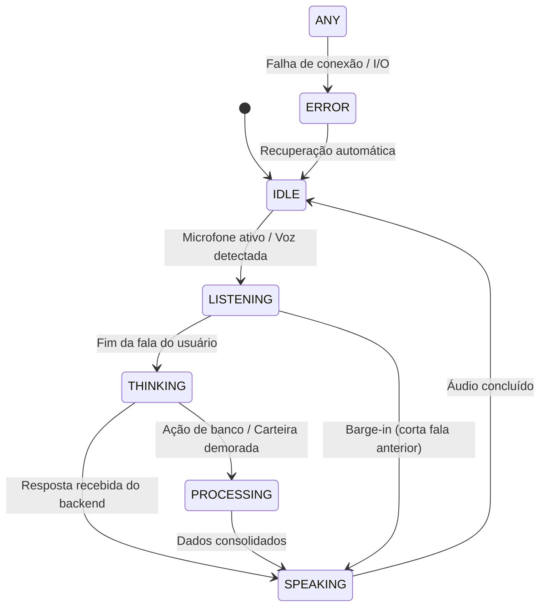

# Sexta-Feira — Sistema de Design Holográfico & HUD Cinético

## 1. Filosofia Visual

A identidade visual da **Sexta-Feira** rompe categoricamente com templates convencionais de chat ou painéis SaaS corporativos. A estética é inspirada em interfaces de comando avançadas, holografia quântica e terminais táticos de ficção científica de alta precisão (como a interface original de Jarvis e Sexta-Feira no Universo Marvel), aliada ao minimalismo escandinavo moderno.

### Princípios Cardeais
1. **Profundidade Luminosa (Glow & Glass):** Superfícies translúcidas em camadas profundas, com desfoque de fundo (*backdrop blur*), bordas com chanfros táticos e iluminação aditiva baseada em emissores de luz.
2. **Geometria Tática e HUD:** Linhas de mira, cruzetas táticas, coordenadas polares, indicadores de status monospaçados e *scanlines* sutis que reagem à presença do usuário.
3. **Cinética Orgânica:** O núcleo holográfico central não é estático nem pré-gravado. É uma malha de filamentos de energia e nuvem de partículas orientadas por ruído simplex procedimental que respira, vibra e reage instantaneamente ao tom e à intensidade da voz em tempo real.
4. **Legibilidade Máxima:** A interação textual e as métricas financeiras utilizam contraste calibrado sobre fundos escuros, preservando conforto ocular em sessões prolongadas.

---

## 2. Paleta de Cores e Tokens Visuais

### Cores Primárias de Emissão (Holographic Glow)
| Token | Cor Hex | Uso Principal |
| :--- | :--- | :--- |
| `--hologram-cyan` | `#00f3ff` | Emissão primária da assistente, filamentos centrais, links e foco ativo. |
| `--hologram-blue` | `#0066ff` | Profundidade luminescente, auras secundárias e halos de difração. |
| `--hologram-purple` | `#7928ca` | Modos analíticos, transição de pensamento e IA profunda. |
| `--hologram-gold` | `#f5a623` | Alertas moderados, investimentos e modo executivo. |
| `--hologram-red` | `#ff0055` | Violação de orçamento, erros críticos e interrupção imediata (*barge-in*). |
| `--hologram-green` | `#00ff88` | Confirmação de receitas, saldo positivo e sincronização bem-sucedida. |

### Cores de Fundo e Estrutura (Obsidian Matrix)
| Token | Cor Hex | Uso Principal |
| :--- | :--- | :--- |
| `--bg-void` | `#030712` | Fundo principal da aplicação (escuridão abissal que destaca os brilhos). |
| `--bg-panel` | `rgba(10, 18, 36, 0.65)` | Superfícies com vidro tático e desfoque (*backdrop-filter: blur(16px)*). |
| `--border-hologram`| `rgba(0, 243, 255, 0.22)`| Contornos de cards, divisores e chanfros de HUD. |
| `--text-primary` | `#f0f6fc` | Textos conversacionais principais e balões da assistente. |
| `--text-muted` | `#6e7681` | Timestamps, metadados técnicos e coordenadas. |

---

## 3. Os 6 Estados do Núcleo Holográfico 3D

O núcleo central reage tanto às intenções e respostas do backend quanto à amplitude sonora capturada pelo microfone via Web Audio API.

### Especificação dos Estados

1. **IDLE (Em Repouso / Vigilância Suave):**
   - **Visual:** Filamentos orbitais girando em velocidade constante e suave em torno de um núcleo translúcido; partículas internas flutuando suavemente.
   - **Cor dominante:** Ciano profundo (`#00a8b5` a `#00f3ff`), emissão média (0.4).
   - **Áudio:** Pulso rítmico imperceptível de respiração (0.2 Hz).

2. **LISTENING (Ouvindo o Usuário):**
   - **Visual:** O núcleo se expande ligeiramente; anéis externos oscilam concentricamente em resposta direta ao espectro de frequência do microfone capturado via `AnalyserNode`.
   - **Cor dominante:** Turquesa elétrico vivo (`#00f3ff`), brilho intenso (0.85).
   - **Reatividade:** Amplitude da malha de filamentos diretamente mapeada ao RMS sonoro do microfone.

3. **THINKING (Processando / Raciocinando):**
   - **Visual:** Os filamentos se contraem em direção ao centro e aceleram sua rotação; feixes de partículas azuis e violetas viajam rapidamente pelos vórtices.
   - **Cor dominante:** Violeta quântico pulsante (`#7928ca` a `#a855f7`).
   - **Frequência de pulso:** 1.5 Hz a 2.5 Hz com transições suaves.

4. **SPEAKING (Falando a Resposta):**
   - **Visual:** Ondas esféricas emitem-se do centro para fora no ritmo exato do envelope sonoro do TTS (ondas sonoras visíveis). Os filamentos ondulantes acompanham as vogais e silabas pronunciadas.
   - **Cor dominante:** Ouro-ciano vibrante (`#00f3ff` com reflexos esmeralda `#00ff88`).
   - **Barge-in:** Se o usuário falar durante este estado, o visual colapsa instantaneamente e transiciona de volta para `LISTENING` em menos de 100ms.

5. **PROCESSING (Operação Financeira / Transação em Lote):**
   - **Visual:** O núcleo se divide em nós orbitais secundários representando os registros da carteira ou transações orçamentárias sendo atualizadas.
   - **Cor dominante:** Âmbar holográfico (`#f5a623`).

6. **ERROR (Falha / Offline):**
   - **Visual:** A malha de filamentos sofre interferência estática (*glitch* shader no vertex pass); partículas dispersas em padrão assimétrico.
   - **Cor dominante:** Carmesim tático (`#ff0055`).

---

## 4. Tipografia e Hierarquia

- **Display & Monospace (Técnico / HUD / Métricas):** `JetBrains Mono`, `Fira Code`, monospace.
  - Usado para: Saldo, relógio UTC/local, taxas de câmbio, indicadores de estado e logs de IA.
- **Interface & Diálogo (Conversação / Leitura Fluida):** `Inter`, system-ui, -apple-system, sans-serif.
  - Usado para: Balões de mensagem da assistente e do usuário, títulos de notificações e configurações.

---

## 5. Componentes de HUD (Tactical Glass & Overlays)

1. **Cantoneiras Táticas:** Bordas de containers cortadas em ângulo chanfrado de 45° com traço ciano fino.
2. **Scanlines Dinâmicas:** Linhas horizontais sutis com 4% de opacidade que se movem verticalmente pelo viewport, simulando uma projeção holográfica de laser de estado sólido.
3. **Medidor de Frequência de Áudio (HUD Audio Bar):** Barras verticais reativas dispostas na base do holograma mostrando as frequências baixas, médias e agudas em tempo real.
4. **Painel Retrátil de Telemetria Financeira:** Gaveta lateral de vidro escuro exibindo resumo do mês, status dos orçamentos e últimos lançamentos sem cobrir o núcleo holográfico.
